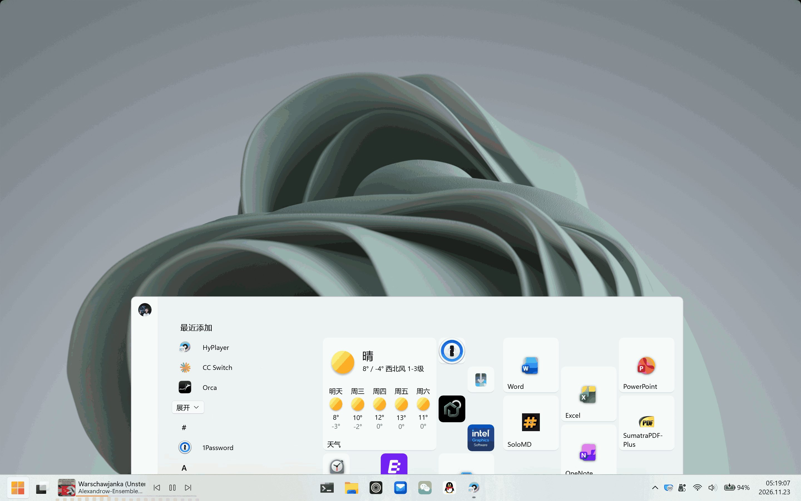
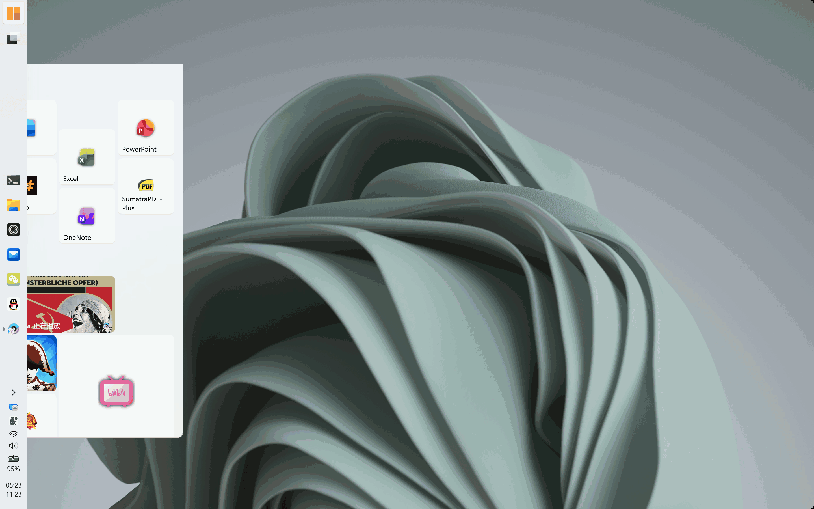

**English** | [简体中文](https://github.com/Zhanyuanium/swipe-for-10start/blob/main/README.zh-CN.md)

# Swipe for 10Start

Touch and pen swipe gestures for the legacy Windows 10 Start menu that
ExplorerPatcher restores on Windows 11. Swipe in from the taskbar edge and the
menu opens following your finger; drag the open menu back toward that edge and
it slides away and closes. Keyboard opens and closes get the same animation.
By Zhanyuanium, distributed as a Windhawk mod.

## What you need

- **Windows 11** with **ExplorerPatcher** set to the Windows 10 (legacy) Start
  menu (`Start_ShowClassicMode=1`). Verified on Windows 11 build 26300.10075
  (`twinui.pcshell.dll` fixed 10.0.26100.10068) and ExplorerPatcher 26100.9711.
- **Windhawk**.
- A touchscreen or pen. (The mouse is deliberately not used for these
  gestures.)

## The mod

One Windhawk mod ships, and it runs in both processes it needs: the gesture and
the animation live in StartMenuExperienceHost, the shell calls in Explorer.

Swipe in from the taskbar edge and the menu opens following your finger; drag
the open menu back toward the edge and it slides away. The Windows key, the
Start button and a click on the desktop use the same animation.

A press or a pull during a close takes the menu back while it is still on
screen: the close stops where it is and the panel reverses. A close that has
already landed is final for that finger; the next open needs a new touch.
Win+Tab, the lock screen and a display change pass through untouched.

If Explorer's half cannot run on this build, the menu still opens and closes,
but the close is instant; touch and pen gestures keep following your finger in
the Start host.

## Install

Install **Swipe for 10Start** from Windhawk and enable it. Enabling or updating
attaches to the menu host that is already running; no Explorer or Start menu
restart is needed.

## Settings

- **Menu animation style** (`AnimationStyle`, default `Windows 11`) — the
  shape of the slide. `Windows 11` is fitted to the motion of the system's own
  panels (the Quick Settings flyout); `Windows 10` is the feel the mod shipped
  with originally, a looser spring that can overshoot slightly. Both run the
  same spring — the choice changes the feel, never the mechanism — and it also
  decides how opening and closing with the Windows key looks.
- **Animation start speed (% of swipe speed)** (`GestureStartSpeedPercent`,
  default 100, range 0-300) — how fast the menu keeps moving the moment you
  lift your finger, as a percentage of the finger's speed in the direction the
  menu is going. 100 continues at finger speed, higher values snap away
  faster, 0 always starts the animation from a standstill. A finger that was
  held still starts from rest whatever this says, and Windows-key opens always
  start from rest — this setting does not affect them.
- **Drag intent distance (% of travel)** (`CommitDistancePercent`,
  default 10, range 1-50) — how far a drag must go toward the target before
  releasing commits it. A pull that travels less than this springs back closed;
  a close drag that travels less than this reverses back open. The same value
  applies on every taskbar side, and a quick flick commits even when it is
  shorter.
- **Write a diagnostic trace file** (`DiagnosticTrace`, default off) — turns on
  the decision log described below. Leave it off for everyday use; a bug report
  or a maintainer will ask for it.

## What works where

- Taskbar on the **left**, **top**, **right** or **bottom**. **Auto-hide** is
  supported.
- **One display.** A taskbar on a secondary monitor or a rotated display is not
  supported; every measurement is the primary panel.
- **Touch** works. **Pen** input is decoded (hover is ignored) but has not yet
  been exercised by hand.
- On a top or bottom taskbar, a vertical swipe inside the open menu scrolls
  what is under your finger — the app list, or the grid of pinned tiles — and
  becomes a dismiss only once that area reaches its end.
- A pull that starts just inside the screen edge — up to about half a taskbar's
  height, the strip the system's own swipe opens from — opens the menu, and the
  menu follows the finger from the frame it appears. A tap on the taskbar
  background does not request a touch open: the mod asks for the menu only after
  the finger has travelled 24 DIP away from the edge. A tap on a pinned app,
  the clock or the tray stays a native press; a tap on the Start button still
  opens the menu, as it always does. A pull that starts further in does not open
  it: only the taskbar edge does that.
- Mouse drag is deliberately not enabled.

## Try it

- Swipe in from the taskbar edge: the menu opens and follows your finger. A
  swipe that begins a little further in, about half a taskbar's height, keeps
  up with your hand too instead of snapping open. A quick flick that ends
  before the menu appears still carries its speed into the opening motion, and
  the menu rises from the bottom edge instead of appearing part-way open. A
  short or reversed pull springs back; a longer pull or a flick keeps it open.
- With the menu open, drag it toward the taskbar edge to dismiss it — past the
  drag-intent distance (a tenth of the panel's travel by default), or with a
  flick, it commits and slides out.
- Press the Windows key: the same animation plays on open and on close.

## If something looks wrong

- The mod can write a decision log into two files in its Windhawk storage
  folder, which Windhawk shows on the mod's page: `renderer.log` from the Start
  half and `bridge.log` from the Explorer half, both under `swipe-for-10start`.
  They are written only while **Write a diagnostic trace file**
  (`DiagnosticTrace`) is on; turn it on once from an elevated shell with
  `windhawk-cli mod settings set swipe-for-10start DiagnosticTrace=true`
  or from the mod's settings, then reproduce the problem.
- The root hook is found by public symbol, not by address. If `StartUI_.dll`
  does not carry `StartUI::App::PrepareRootElement` (or its symbols cannot be
  read), no gesture starts and the log shows `startui root symbol unresolved
  ...`; the shell then handles every press natively.
- While the menu is being dragged, its contents still receive touches at their
  original positions — a known limit, along with the assumption that the touch
  panel covers the primary monitor.
- The full technical documentation — what was measured, what was falsified,
  and every design decision — lives in
  [docs/](https://github.com/Zhanyuanium/swipe-for-10start/blob/main/docs/README.md),
  including the complete
  [known-limits list](https://github.com/Zhanyuanium/swipe-for-10start/blob/main/docs/limits.md).
- [CHANGELOG.md](https://github.com/Zhanyuanium/swipe-for-10start/blob/main/CHANGELOG.md)
  lists each release tag with the version it shipped.
- Building and installing from source is covered in
  [docs/development.md](https://github.com/Zhanyuanium/swipe-for-10start/blob/main/docs/development.md).
