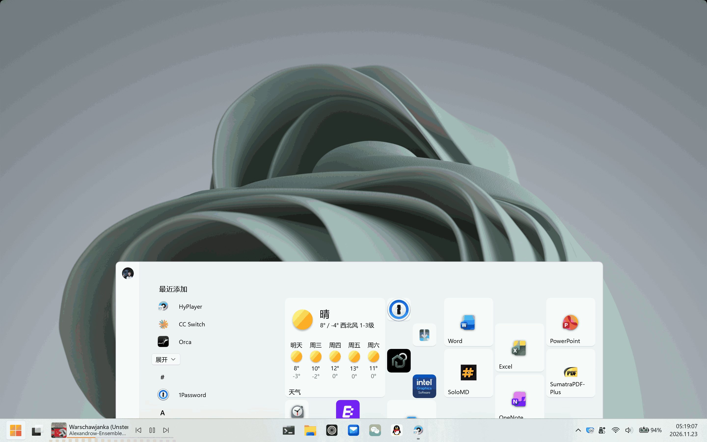
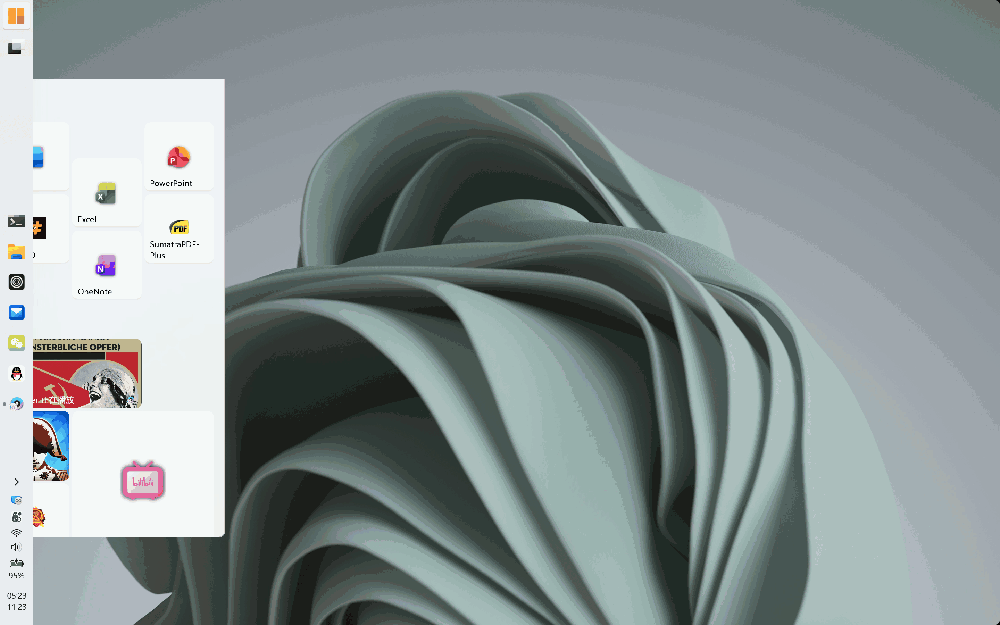

[English](https://github.com/Zhanyuanium/swipe-for-10start/blob/main/README.md) | **简体中文**

# Swipe for 10Start

ExplorerPatcher 在 Windows 11 上恢复了经典的 Windows 10 开始菜单；本模组为它加上触摸和手写笔滑动手势。从任务栏所在的屏幕边缘划入，菜单会跟随手指打开；把已打开的菜单往该边缘拖回，菜单会滑出并关闭。用键盘打开或关闭菜单时播放同一套动画。由 Zhanyuanium 开发，以 Windhawk 模组形式发布。

## 你需要什么

- **Windows 11**，且 **ExplorerPatcher** 已设置为 Windows 10（经典）开始菜单（`Start_ShowClassicMode=1`）。已在 Windows 11 build 26300.10075（`twinui.pcshell.dll` 固定版本 10.0.26100.10068）和
  ExplorerPatcher 26100.9711 上验证。Explorer 半边只在这个精确的 `twinui.pcshell.dll` 版本上启用私有启动器调用；Windows 更新改变该文件后，菜单仍能开合，但关闭会变成瞬间的，直到模组针对新版本更新。切换到 Windows 10 开始菜单后，请重启 Explorer 和 StartMenuExperienceHost，或注销后重新登录，模组才会加载。
- **Windhawk**。
- 触摸屏或手写笔。（本模组刻意不响应鼠标拖动。）

## 模组由两部分组成

只发布一个 Windhawk 模组，同时运行在需要的两个进程中：手势和动画在 StartMenuExperienceHost 里，系统调用在 Explorer 里。

从任务栏边缘划入，菜单跟随手指打开；把已打开的菜单往该边缘拖回，菜单滑出关闭。Win 键、开始按钮和点击桌面播放同一套动画。

关闭过程中再按一次或再拉一次，只要窗口还在屏幕上，就会取消这次关闭，并从当前位置反向回弹；已经落地的关闭不会被同一根手指重新打开，下一次打开需要新的触摸。Win+Tab、锁屏和显示变化直接透传。

如果 Explorer 的半边在当前系统版本上无法运行，菜单仍能开合，但关闭是瞬间的；Start 半边里的触摸和手写笔手势仍会跟随手指。

## 安装

在 Windhawk 中安装 **Swipe for 10Start** 并启用。启用或更新会挂到正在运行的菜单宿主上，不需要重启 Explorer 或开始菜单宿主。

## 设置项

- **菜单动画样式**（`AnimationStyle`，默认 `Windows 11`）——滑动动画的曲线形状。`Windows 11` 拟合自系统自带面板（快速设置弹出面板）的动作；`Windows 10` 是本模组最初发布时的手感，弹簧更松，可能略微过冲。两者跑的是同一条弹簧——这个选择只改手感，不改机制——同一个选择也决定按 Windows 键开合菜单时的动画。
- **动画起步速度（占滑动速度的百分比）**（`GestureStartSpeedPercent`，默认 100，范围 0–300）——松手瞬间菜单继续滑动的速度，取手指朝菜单目标方向的速度分量的百分比。100 表示按手指速度继续；更大的值甩得更快；0 总是从静止起步。手指停住再抬起时无论设多少都从静止起步；用 Windows 键打开也总是从静止起步——这两种情况都不受这个设置影响。
- **拖动意图距离（占行程的百分比）**（`CommitDistancePercent`，默认 10，范围 1–50）——拖动朝目标方向走多远，松手才算数。拉开不足这个距离会弹回关闭状态；收回不足这个距离会回弹重新打开。四个任务栏方向共用同一个值；快速一甩即使距离更短也会生效。
- **写入诊断跟踪文件**（`DiagnosticTrace`，默认关闭）——打开下文所述的决策日志。日常使用请保持关闭；只有在维护者或缺陷报告要求时才打开。

## 适用的场景

- 任务栏在**左侧**、**顶部**、**右侧**或**底部**。支持**自动隐藏**。
- **单块显示器。** 任务栏放在副屏、或屏幕旋转后，均不支持；所有测量都来自主显示器。
- **触摸**可用。**手写笔**输入已解码（悬停被忽略），但尚未在真机上实测过。
- 任务栏在顶部或底部时，在已打开的菜单里上下滑动，会先滚动手指下方的内容（应用列表，或固定磁贴的网格）；等这块区域滚到底，同一次滑动才开始关闭菜单。
- 从屏幕边缘稍微靠里一点起手——大约半个任务栏高，也就是系统自带滑动的起手范围——菜单会打开，并且从出现的那一帧起就跟随手指。单击任务栏空白不会请求触摸打开：手指要朝桌面方向移动满 24 DIP，模组才会请求打开。点在固定应用、时钟或托盘上是一次原生点击；点开始按钮仍会打开菜单，和平时一样。起手位置更靠里则不会打开菜单：只有任务栏边缘能打开它。
- 鼠标拖动刻意未启用。

## 上手一试

- 从任务栏边缘划入：菜单打开并跟随手指。从稍微靠里一点（约半个任务栏高）起手也会跟随手指，不会在手底下直接弹开。快速一甩若在菜单出现之前就离手，菜单也会顺着这股速度从屏幕边缘升起，而不是先停一下、再以半开的样子出现。拉得短或往回推会弹回去；拉得更长或快速一甩则保持打开。
- 菜单打开时，把它往任务栏边缘拖即可关闭——拖过拖动意图距离（默认是面板行程的十分之一），或快速一甩，就构成一次关闭手势，菜单随之滑出。
- 按 Windows 键：打开和关闭时播放同一套动画。

## 如果看起来不对

- 模组可以把决策日志写进它的 Windhawk 存储目录（Windhawk 在模组页面上显示该路径）下的两个文件：Start 半边的 `renderer.log` 和 Explorer 半边的 `bridge.log`，都在 `swipe-for-10start` 下。只有打开 **写入诊断跟踪文件**（`DiagnosticTrace`）时才会写；打开一次即可：
  `windhawk-cli mod settings set swipe-for-10start DiagnosticTrace=true`，
  也可以在模组设置里打开（命令行需要管理员权限），然后复现问题。
- 根钩子按公开符号查找，不依赖固定地址。若 `StartUI_.dll` 不含 `StartUI::App::PrepareRootElement`（或读不到符号），手势不会启动，日志里会看到 `startui root symbol unresolved ...`；此时所有按键都交给系统自行处理。
- 拖动菜单期间，菜单内容仍在原位置接收触摸——这是已知限制；另一条已知限制：本模组假设触摸面板覆盖主显示器。
- 完整的技术文档在 [docs/](https://github.com/Zhanyuanium/swipe-for-10start/blob/main/docs/README.md)（英文），其中有测量数据、被证伪的方案和每项设计决定的理由，也包括完整的[已知限制列表](https://github.com/Zhanyuanium/swipe-for-10start/blob/main/docs/limits.md)。
- 每次发布的 tag 与对应的版本号见 [CHANGELOG.zh-CN.md](https://github.com/Zhanyuanium/swipe-for-10start/blob/main/CHANGELOG.zh-CN.md)（英文版 [CHANGELOG.md](https://github.com/Zhanyuanium/swipe-for-10start/blob/main/CHANGELOG.md)）。
- 从源码构建与安装的步骤见 [docs/development.md](https://github.com/Zhanyuanium/swipe-for-10start/blob/main/docs/development.md)。
